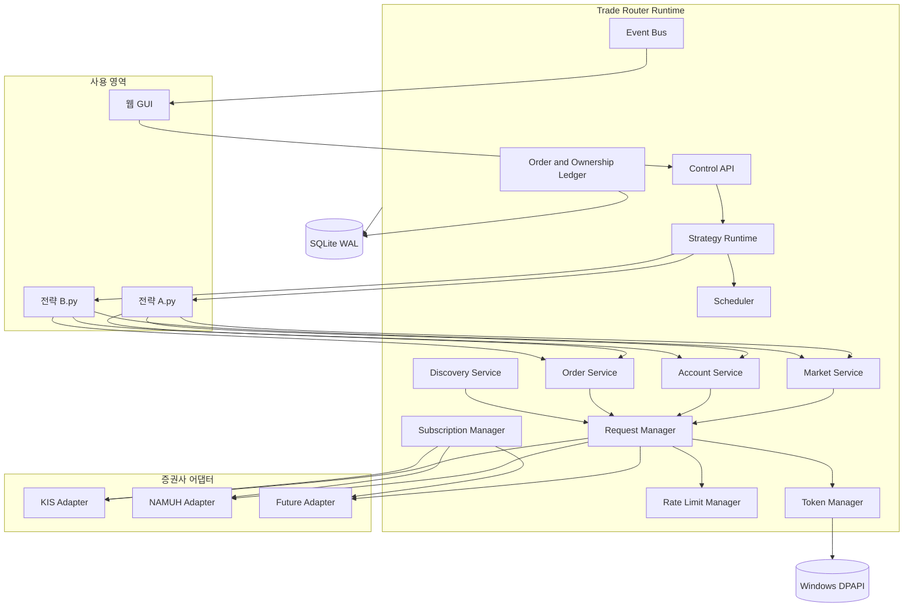
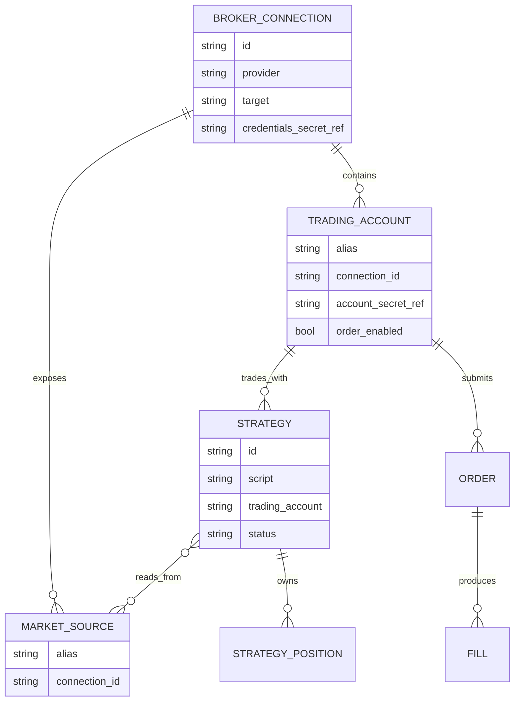
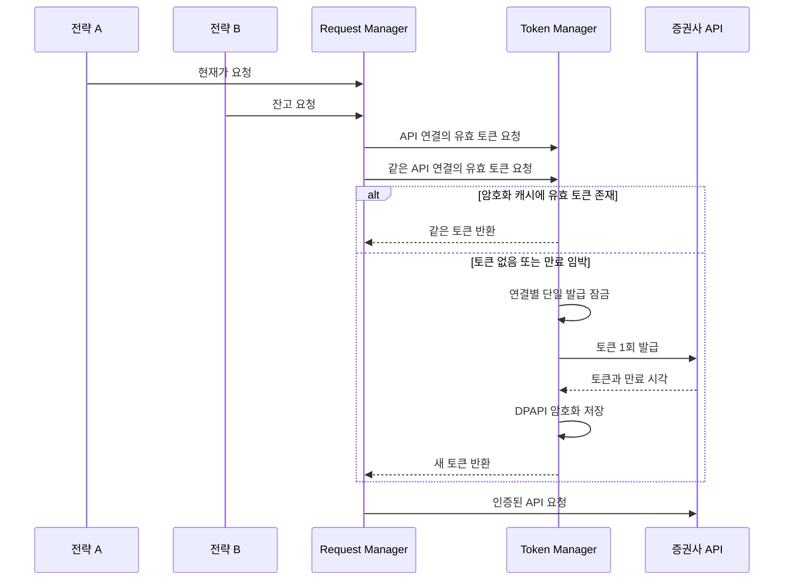
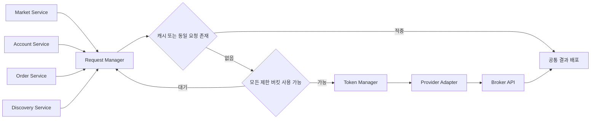
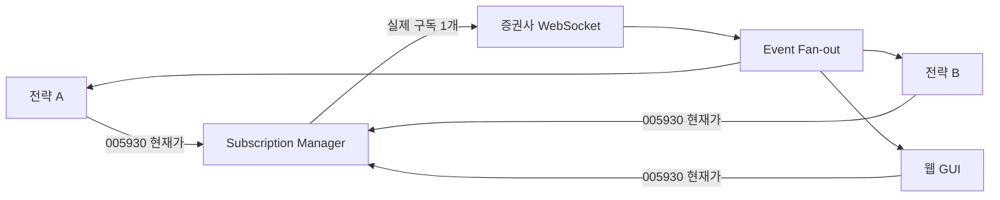
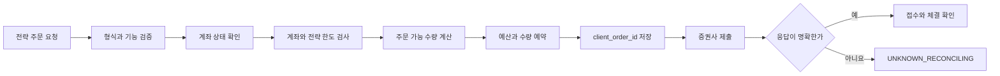
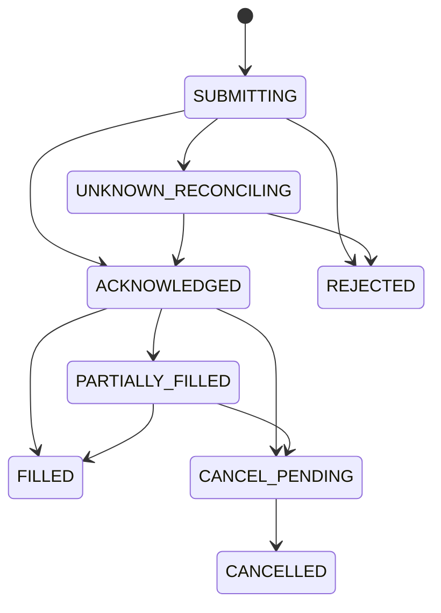
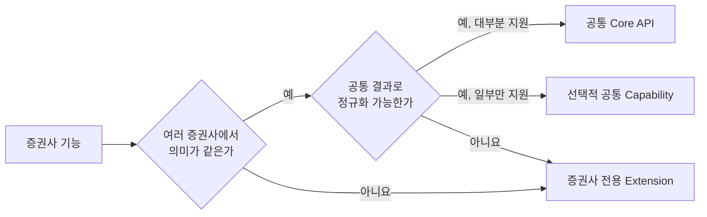
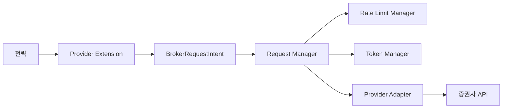

# Trade Router 최종 설계

## 1. 문서 목적

Trade Router는 개인 컴퓨터에서 Python 자동매매 전략을 작성하고 실행하는
가벼운 로컬 프로그램이다. 증권사별 인증, 호출 제한, 데이터 형식과 주문 절차는
중앙 Runtime이 통일하고, 전략은 공통 Python API만 사용한다. 웹 GUI는 같은
Runtime의 설정과 실행 상태를 보여주는 관리 화면이다.

이 문서는 목표 구조와 구현 규칙을 정의한다. 현재 저장소의 구현 범위는 이
설계의 일부이며, 완성 여부는 `README.md`의 현재 구현 범위에서 별도로 관리한다.

## 2. 확정된 설계 원칙

1. 사용자에게 보이는 제품은 Trade Router 하나다.
2. 실행 시 로컬 Runtime과 웹 GUI가 함께 시작된다.
3. 전략은 일반 Python 파일과 `Strategy` 클래스로 작성한다.
4. 전략과 GUI는 증권사 API를 직접 호출하지 않는다.
5. 외부 REST 요청은 모두 `RequestManager`를 통과한다.
6. 실시간 연결과 구독은 모두 `SubscriptionManager`를 통과한다.
7. API 키, 접근 토큰과 전체 계좌번호는 전략 프로세스에 전달하지 않는다.
8. 같은 API 연결을 사용하는 전략은 하나의 유효 토큰을 공유한다.
9. 한 전략은 여러 증권사의 데이터를 사용할 수 있다.
10. 주문 계좌는 전략 설정에 명시하고 주문 시 임의로 바꾸지 않는다.
11. 가격과 금액은 `Decimal`, 시각은 시간대가 포함된 `Asia/Seoul` 기준을 쓴다.
12. 제품에는 관찰 모드를 두지 않는다. 모의·실전 여부는 계좌가 연결된 접속
    대상으로 결정한다.
13. 테스트용 증권사 구현은 제품 UI에 노출하지 않고 `tests/testkit`에서만 쓴다.

## 3. 시스템 전체 구조



### 3.1 프로세스 구성

```text
run.cmd
└─ Trade Router Runtime
   ├─ 로컬 웹 서버
   ├─ 중앙 서비스
   ├─ 전략 A Python 프로세스
   ├─ 전략 B Python 프로세스
   └─ 증권사 REST·WebSocket 연결
```

- 사용자에게는 명령 창 하나만 표시한다.
- 브라우저를 닫아도 Runtime과 실행 중인 전략은 유지한다.
- 명령 창을 닫으면 새 주문 권한을 먼저 해제하고 전략 프로세스를 정리한 뒤
  Runtime을 종료한다.
- 전략마다 별도 프로세스를 사용하여 한 전략의 예외나 무한 루프가 다른 전략과
  중앙 Runtime을 중단시키지 않게 한다.

## 4. 핵심 등록 모델

사용자에게 보이는 등록 단위는 `API 연결`, `계좌`, `전략`이다.



### 4.1 API 연결

```python
BrokerConnection(
    id="kis-paper",
    provider="kis",
    target="PAPER",
    credentials_secret_ref="secret:...",
)
```

- `target`은 `PAPER` 또는 `LIVE`다.
- 모의 접속을 제공하지 않는 증권사는 `LIVE`만 선택할 수 있다.
- 토큰, REST 상태, WebSocket 상태와 호출 제한은 API 연결 단위로 관리한다.

### 4.2 계좌

```python
TradingAccount(
    alias="kis-paper-main",
    connection_id="kis-paper",
    account_secret_ref="secret:...",
    product_code="01",
    order_enabled=True,
)
```

하나의 API 연결에 여러 계좌를 등록할 수 있다. 같은 연결을 사용하는 계좌는
해당 증권사 정책이 허용하는 범위에서 토큰과 통신 연결을 공유한다.

### 4.3 전략

```python
StrategyConfig(
    id="bollinger-breakout",
    script="bollinger.py",
    trading_account="kis-paper-main",
    market_sources={
        "primary": "kis-paper",
        "secondary": "namuh-live",
    },
    limits=RiskLimits(
        max_order_amount=50_000,
        max_daily_buy_amount=300_000,
        max_daily_buy_count=10,
        max_open_orders=5,
    ),
)
```

- `trading_account`는 주문에 사용할 계좌다.
- `market_sources`는 전략 코드에서 사용할 수 있는 시세 연결의 허용 목록이다.
- 초기 구현은 전략당 주문 계좌 하나를 지원한다.
- 향후 다중 계좌 주문은 허용 계좌를 설정에 명시하는 방식으로 확장한다.

## 5. 전략 공개 API

전략은 `StrategyContext`를 통해서만 중앙 기능을 사용한다.

```text
StrategyContext
├─ market
│  ├─ source(alias)
│  ├─ quote()
│  ├─ orderbook()
│  ├─ bars()
│  ├─ search()
│  └─ subscribe_quotes()
├─ account
│  ├─ balance()
│  ├─ positions()
│  ├─ position()
│  ├─ strategy_positions()
│  ├─ open_orders()
│  └─ fills()
├─ orders
│  ├─ market_buy()
│  ├─ market_sell()
│  ├─ limit_buy()
│  ├─ limit_sell()
│  ├─ cancel()
│  └─ replace()
├─ scheduler
│  ├─ every()
│  ├─ on_bar_close()
│  ├─ daily_at()
│  ├─ on_market_open()
│  └─ on_market_close()
├─ state
│  ├─ get()
│  └─ set()
└─ log
```

```python
from trade_router import Strategy, StrategyContext


class BollingerStrategy(Strategy):
    id = "bollinger-breakout"

    async def on_start(self, ctx: StrategyContext) -> None:
        ctx.scheduler.on_bar_close(
            interval="3m",
            schedule_id="morning",
            between=("09:00", "10:00"),
        )
        ctx.scheduler.on_bar_close(
            interval="3m",
            schedule_id="day",
            between=("10:00", "15:00"),
        )
        ctx.scheduler.daily_at("15:00", schedule_id="close-all")

    async def on_bar(self, ctx: StrategyContext, event) -> None:
        if event.schedule_id == "morning":
            await self.run_morning_rule(ctx, event)
        elif event.schedule_id == "day":
            await self.run_day_rule(ctx, event)

    async def on_timer(self, ctx: StrategyContext, event) -> None:
        if event.schedule_id == "close-all":
            for position in await ctx.account.strategy_positions():
                await ctx.orders.market_sell(
                    code=position.code,
                    quantity=position.quantity,
                )
```

지원하는 전략 이벤트는 다음과 같다.

```python
on_start(ctx)
on_quote(ctx, quote)
on_orderbook(ctx, orderbook)
on_bar(ctx, bar_event)
on_timer(ctx, timer_event)
on_order(ctx, order)
on_fill(ctx, fill)
on_stop(ctx)
```

전략 콜백은 기본적으로 전략별 직렬 실행한다. 이전 콜백이 끝나기 전에 같은
전략의 다음 콜백을 겹쳐 실행하지 않는다.

## 6. 스케줄러

스케줄러는 매수·매도 조건을 판단하지 않는다. 거래일, 시간 구간, 실행 주기와
완성 봉 시점을 관리하고 해당 이벤트를 전략에 전달한다.

```mermaid
timeline
    title 시간대별 전략 실행
    09:00 : morning 구간 시작
          : 오전 규칙 활성화
    10:00 : morning 구간 종료
          : day 구간 시작
          : 주간 규칙 활성화
    15:00 : day 구간 종료
          : close-all 이벤트
```

시간 범위는 시작 포함, 종료 제외로 해석한다.

```text
morning: 09:00:00 이상, 10:00:00 미만
day:     10:00:00 이상, 15:00:00 미만
```

`on_bar_close("3m")`는 벽시계만 보고 호출하지 않는다. `MarketService`가 해당
구간의 완성 봉을 확정한 뒤 이벤트를 발생시킨다.

PC 절전이나 장시간 정지 후 복귀했을 때 밀린 짧은 주기 이벤트를 한꺼번에
실행하지 않는다. 기본 정책은 지나간 타이머 이벤트를 건너뛰고 다음 정렬 시각부터
재개하는 것이다. 누락 봉은 데이터 복구 대상으로 조회하되 과거 신호 주문 여부는
전략 설정으로 결정한다.

## 7. 여러 증권사의 데이터 사용

`source`는 데이터를 제공한 API 연결이고, `venue`는 실제 거래 시장이다.

```text
source: KIS 또는 NAMUH
venue:  KRX, NXT 또는 INTEGRATED
route:  KRX, NXT, SOR 또는 AUTO
```

```python
kis_quote = await ctx.market.source("primary").quote(
    code="005930",
    venue="INTEGRATED",
)

nh_quote = await ctx.market.source("secondary").quote(
    code="005930",
    venue="INTEGRATED",
)
```

공통 응답에는 출처와 최신성 판단에 필요한 정보를 포함한다.

```python
Quote(
    instrument=InstrumentId(code="005930"),
    price=Decimal("95000"),
    provider="kis",
    source_alias="primary",
    venue="INTEGRATED",
    market_time=...,
    received_at=...,
    connection_generation=7,
    stale=False,
    correlation_id="...",
)
```

공급자 자동 전환은 기본 동작으로 사용하지 않는다. 전략이 `FALLBACK`,
`FRESHEST`, `CONSENSUS` 같은 정책을 명시한 경우에만 해당 정책을 적용한다.

## 8. 토큰 관리



토큰 공유 키는 어댑터가 결정한다. 기본 범위는 다음과 같다.

```text
증권사 + API 연결 + 접속 대상
```

토큰 갱신 규칙:

- 유효한 암호화 캐시가 있으면 재사용한다.
- 만료 시각에 안전 여유를 두고 갱신한다.
- 같은 연결의 동시 발급 요청은 하나로 합친다.
- 토큰 발급 실패를 짧은 주기로 반복하지 않는다.
- 인증 실패를 받은 조회 요청은 새 토큰으로 한 번만 재시도할 수 있다.
- 주문 제출 응답이 불명확하면 인증 갱신 후 자동 재전송하지 않는다.

## 9. 요청과 호출 한도 관리

모든 REST 요청은 `RequestManager`에 `BrokerRequestIntent`로 등록한다.

```python
BrokerRequestIntent(
    connection_id="kis-live",
    operation="market.quote",
    priority="STRATEGY_DATA",
    dedupe_key="kis-live:quote:005930:INTEGRATED",
    cache_ttl=0.5,
    deadline=...,
)
```



호출 제한은 계층형으로 적용한다. 연결 이름이 아니라 증권사·접속 대상·App Key의
불투명 지문을 최상위 범위로 사용하므로, 같은 키를 여러 연결 이름으로 등록해도
하나의 공용 버킷을 소비한다. 요청 하나가 여러 제한 범위를 동시에 소비할 수 있다.

```text
KIS 현재가 요청
├─ KIS 연결 전체 버킷
└─ KIS 시세 API 버킷

KIS 주문 요청
├─ KIS 연결 전체 버킷
├─ KIS 주문 API 버킷
└─ 계좌 주문 버킷
```

요청 우선순위:

1. 접수 여부가 불명확한 주문 조정
2. 주문 취소와 위험 관리
3. 주문 사전조회와 주문 제출
4. 체결·미체결·잔고 확인
5. 실행 중인 전략에 필요한 시세
6. 조건검색과 종목 탐색
7. 사용자가 보고 있는 GUI 조회
8. 긴 과거 데이터 조회

낮은 우선순위가 영구적으로 밀리지 않도록 가중 공정 큐와 사용자 조회용 최소
처리량을 둔다. 조회 재시도는 제한적으로 허용하고, 주문은 접수 여부가 불명확한
상태에서 자동 재전송하지 않는다.

## 10. REST 캐시와 중복 요청

다음 값이 모두 같은 조회만 하나로 합친다.

```text
API 연결
종목
venue
조회 종류
봉 주기
조회 구간과 개수
수정주가 여부
공급자 전용 옵션
```

동일한 현재가 요청을 전략 둘과 GUI가 동시에 보내도 증권사 요청은 한 번만
실행하고 결과를 세 요청자에게 배포한다. 계좌와 주문 관련 캐시는 별도의 짧은
최신성 기준을 사용하며 주문 사전검사는 필요한 경우 새 조회를 강제한다.

## 11. WebSocket과 구독



- 구독은 참조 수로 관리한다.
- 마지막 사용자가 해제할 때 증권사 구독을 해제한다.
- 들어오는 실시간 이벤트는 REST 호출 횟수에 포함하지 않는다.
- 연결, 구독과 해제 요청은 별도 제어 한도로 관리한다.
- 재연결 시 연결 세대를 증가시키고 이전 세대의 데이터를 폐기한다.
- 재연결 후 현재 필요한 종목만 다시 구독한다.
- 같은 App Key와 접속 대상의 WebSocket 세션·구독을 중앙에서 공유한다.
- KIS는 2026년 4월 20일 공식 유량 공지에 맞춰 API 키당 1세션과 모든 실시간
  항목 합산 41구독을 쓴다. 공지에 없는 구독 제어 속도는 초당 1회로 보수적으로
  운영한다.
- NAMUH는 공식 SDK에 맞춰 키당 2세션, 세션당 30구독, 구독 제어 초당 10회를
  넘지 않는다.

## 12. 계좌 상태와 전략 소유권

계좌 상태는 REST 스냅샷을 기준으로 주문·체결 이벤트를 반영한다.

```text
REST 잔고 스냅샷
+ 주문 원장
+ 실시간 체결 통보
+ 미체결 조회
= 중앙 계좌 상태
```

실제 계좌의 보유 수량과 전략별 소유 수량을 함께 기록한다.

```text
삼성전자 실제 보유 10주
├─ 전략 A 소유 4주
├─ 전략 B 소유 3주
└─ 미배정 또는 수동 보유 3주
```

시작과 재연결 시 다음 순서로 자동 조정한다.

```text
실제 잔고 조회
→ 미체결 조회
→ 최근 주문·체결 조회
→ 저장된 전략 소유량과 비교
→ 설명 가능한 차이 자동 반영
→ 남는 실제 수량을 미배정 보유로 분류
```

실제 보유량이 저장된 전략 소유량보다 적은 경우 해당 종목의 새 주문을 차단하고
재조정을 계속한다. 다른 계좌와 종목의 실행은 유지한다.

## 13. 주문 처리



`Validate`부터 `Quantity`까지 증권사 제출 전에 거절된 요청은 `PRECHECK BLOCKED`로
취급한다. 이 경우 주문 원장이나 전략의 로컬 제출 대기를 만들지 않으며
`UNKNOWN_RECONCILING`로 전이하지 않는다. `Reserve`와 `client_order_id` 저장을 마치고
증권사 호출 경계를 지난 뒤 응답을 확정하지 못한 경우에만 `UNKNOWN_RECONCILING`을
사용한다. 로컬 응답 유실은 중앙 원장의 정확한 `client_order_id` 행과 대조하며, 행이
없다는 확정적인 증거가 있을 때만 로컬 예약을 제거한다.

계좌 단위 미확정 주문은 신규 매수를 계속 fail-closed로 차단한다. 다만 미확정 주문이
모두 다른 종목의 매수이고, 최신 잔고·증권사 미체결 조회로 동일 종목 충돌과 매도 가능
수량을 다시 검증한 경우에는 보유 위험을 줄이는 매도를 허용한다. 같은 종목의 미확정
주문이나 미확정 매도가 하나라도 있으면 이 예외를 적용하지 않는다.

주문 상태는 다음으로 통일한다.



`client_order_id`는 모든 주문에 필수다. 같은 키의 재요청에는 기존 결과를
반환한다. `UNKNOWN_RECONCILING`에서는 같은 종목의 충돌 주문을 막고 주문내역과
체결통보로 접수 여부를 확인한다.

## 14. 공통 API와 증권사 전용 확장

증권사 기능은 세 단계로 구분한다.



### 14.1 공통 Core API

여러 증권사에서 의미와 결과가 같은 기능은 공통 서비스에 둔다.

```text
market.quote
market.orderbook
market.bars
account.balance
account.positions
account.open_orders
orders.market_buy
orders.limit_sell
```

전략은 증권사를 바꾸더라도 같은 코드를 사용할 수 있다.

### 14.2 선택적 공통 Capability

결과를 공통 형태로 표현할 수 있지만 일부 증권사만 제공하는 기능은 선택적
Capability로 둔다. 저장 조건검색, 순위, 투자자별 동향처럼 공급자별 지원 여부가
다른 기능이 여기에 해당할 수 있다.

```python
if await ctx.capabilities.supports(
    "discovery.saved_conditions",
    source="primary",
):
    conditions = await ctx.discovery.source("primary").saved_conditions()
```

지원하지 않는 연결에서 호출하면 외부 요청 전에
`UNSUPPORTED_CAPABILITY`를 반환한다. 유사한 다른 기능으로 자동 대체하지 않는다.

### 14.3 증권사 전용 Extension

증권사에만 존재하거나 의미를 공통 모델로 보존할 수 없는 기능은 타입이 있는
전용 Extension으로 제공한다.

```python
kis = ctx.extensions.for_source("primary").require("kis")

conditions = await kis.hts_conditions.list()
candidates = await kis.hts_conditions.run(
    condition_id=conditions[0].id,
)
```

전용 Extension은 원시 URL이나 임의 HTTP 호출을 노출하지 않는다. 어댑터 패키지가
요청·응답 모델과 검증 규칙을 제공한다. 반환된 종목 목록처럼 공통 표현이 가능한
부분은 `InstrumentCandidate` 등 공통 모델로 변환하고, 증권사 고유 필드는
Extension 전용 모델에 유지한다.

```text
ctx.extensions
├─ for_source("primary")
│  └─ kis
│     ├─ hts_conditions
│     ├─ provider_ranking
│     └─ provider_specific_data
└─ for_source("secondary")
   └─ namuh
      └─ provider_specific_feature
```

전략 설정은 사용할 전용 기능을 미리 선언한다.

```python
StrategyConfig(
    id="kis-condition-strategy",
    market_sources={"primary": "kis-live"},
    required_capabilities={
        "primary": ["kis.hts_conditions.v1"],
    },
)
```

Runtime은 전략 시작 전에 다음을 검증한다.

```text
허용된 데이터 연결인가
→ 실제 공급자가 일치하는가
→ 필요한 Extension과 버전을 지원하는가
→ 현재 접속 대상에서 사용할 수 있는가
→ 필요한 계좌 권한이 있는가
```

검증에 실패하면 전략을 시작하지 않고 정확한 누락 기능을 표시한다. 실행 중
증권사를 자동으로 바꾸거나 비슷한 기능으로 대체하지 않는다.

### 14.4 증권사 전용 주문 옵션

공통 주문에 붙는 작은 차이는 검증된 전용 옵션으로 전달한다.

```python
await ctx.orders.limit_buy(
    code="005930",
    quantity=1,
    price=Decimal("90000"),
    provider_options=KisOrderOptions(...),
)
```

전용 주문 종류처럼 처리 의미 자체가 다른 기능은 Extension 메서드로 분리한다.
어느 방식이든 주문은 공통 `OrderService`의 계좌 한도, 전략 한도, 멱등성 예약과
조정 절차를 반드시 통과한다.

### 14.5 전용 기능의 중앙 처리



따라서 증권사 전용 기능도 다음 공통 운영 규칙을 그대로 적용받는다.

- 토큰 공유와 갱신
- 호출 제한과 요청 우선순위
- 중복 조회 합치기와 캐시
- 연결 세대와 자료 최신성
- 오류 정규화와 상관관계 ID
- 비밀정보 마스킹
- 주문 원장과 멱등성

Capabilities 응답에는 공통 기능과 Extension을 함께 표시한다.

```python
BrokerCapabilities(
    provider="kis",
    quotes=True,
    orderbook=True,
    bars=True,
    accounts=True,
    cash_orders=True,
    extensions={
        "kis.hts_conditions.v1": ExtensionCapability(
            targets=("LIVE",),
        ),
    },
)
```

GUI는 이 정보를 읽어 현재 연결에서 사용할 수 있는 전용 기능만 표시한다.
어댑터가 추가되어도 Core GUI가 증권사별 API 구현을 직접 알 필요가 없도록,
표시 이름과 입력 스키마도 Extension 메타데이터로 제공한다.

## 15. 증권사 어댑터 계약

증권사별 URL, 헤더, 거래 ID와 응답 코드는 어댑터 내부에 둔다.

```python
class ProviderAdapterV1(Protocol):
    provider_id: str

    async def capabilities(self) -> BrokerCapabilities: ...
    def token_scope(self, connection) -> TokenScopeKey: ...
    def rate_limit_scopes(self, request) -> list[RateLimitScope]: ...

    async def issue_token(self, credentials, target): ...
    async def quote(self, session, request): ...
    async def orderbook(self, session, request): ...
    async def bars(self, session, request): ...
    async def balance(self, session, account): ...
    async def positions(self, session, account): ...
    async def open_orders(self, session, account): ...
    async def submit_order(self, session, account, request): ...
    async def cancel_order(self, session, account, request): ...
    async def replace_order(self, session, account, request): ...
    async def connect_stream(self, session): ...
```

지원하지 않는 기능은 외부 요청 전에 `UNSUPPORTED_CAPABILITY`로 거절한다.
증권사 전용 옵션은 어댑터가 제공하는 `provider_options` 스키마로 검증한다.

## 16. 데이터 저장과 보안

```text
%LOCALAPPDATA%\TradeRouter\
├─ config\
│  ├─ settings.json
│  └─ secrets.dpapi
├─ data\
│  ├─ router.db
│  └─ router.db-wal
├─ strategies\
├─ logs\
└─ updates\
```

DPAPI 암호화 대상:

- App Key와 App Secret
- 접근 토큰과 WebSocket 접속키
- 전체 계좌번호

SQLite 저장 대상:

- API 연결과 계좌의 비밀이 아닌 메타데이터
- 전략 설정과 체크포인트
- 주문, 체결과 미체결 원장
- 전략별 소유 수량과 예산 예약
- 실행 이벤트와 오류
- 호출 제한 상태와 마이그레이션 버전

로컬 API는 설치별 인증 토큰으로 보호한다. 전략 프로세스에는 전략 ID에 결속된
짧은 수명의 내부 세션 토큰만 전달한다. 로그, 예외와 진단 출력에서 비밀정보와
전체 계좌번호를 마스킹한다.

## 17. 시작, 복구와 종료

### 시작

```text
설정과 스키마 읽기
→ 암호화 저장소 열기
→ 주문 원장 복구
→ 계좌·미체결·최근 체결 조정
→ REST와 WebSocket 연결 준비
→ 웹 GUI 열기
→ 사용자가 실행한 전략 시작
```

실전 계좌는 조정이 끝난 뒤 주문 권한을 연다. 프로그램 재시작이 중복 주문을
만들지 않도록 저장된 멱등성 키와 불명확 주문을 먼저 복구한다.

### 종료

```text
새 주문 제출 권한 해제
→ 전략에 on_stop 전달
→ 진행 중인 조회와 기록 정리
→ 주문·체결·체크포인트 저장
→ WebSocket 구독 해제와 연결 종료
→ Runtime 종료
```

기존 주문의 자동 취소나 보유 주식 청산은 종료 동작에 포함하지 않는다. 해당
동작은 전략이나 사용자의 명시적인 주문으로 수행한다.

## 18. 웹 GUI 범위

```text
대시보드
├─ Runtime과 증권사 연결 상태
├─ 실행 중인 전략
├─ 요청 큐와 호출 제한
└─ 최근 주문·체결·오류

API·계좌
├─ API 연결 등록
├─ 모의·실전 접속 대상
├─ 계좌 등록
└─ 연결 확인

전략
├─ Python 코드 편집
├─ 사용할 계좌와 데이터 연결 선택
├─ 위험 한도 설정
├─ 시작·중지
└─ 전략 로그

실행 현황
├─ 전략 이벤트
├─ 주문 판단과 차단 사유
├─ 주문·체결·미체결
└─ 전략별 보유량과 손익
```

GUI가 화면 표시를 위해 읽는 운영 상태는 SQLite와 Runtime 캐시를 사용한다.
사용자가 차트나 계좌 새로고침을 요청한 경우에만 실제 조회 수요를 만든다.

## 19. 저장소 목표 구조

```text
trade-router/
├─ packages/
│  ├─ router/                  공통 모델과 SDK
│  ├─ provider-kis/            KIS 어댑터
│  └─ provider-namuh/          NAMUH 어댑터
├─ apps/
│  └─ studio/
│     ├─ runtime/              중앙 처리기
│     ├─ web/                  웹 GUI
│     └─ launcher/             실행·종료·업데이트
├─ tests/
│  ├─ contract/                어댑터 공통 계약
│  ├─ integration/             실제 조회 통합 테스트
│  └─ testkit/                 테스트용 REST·WebSocket 서버
├─ docs/
│  └─ ARCHITECTURE.md
├─ tools/
├─ pyproject.toml
└─ run.cmd
```

## 20. 구현 순서

1. KIS 모의·실전 접속 대상과 `TokenManager`
2. 중앙 `RequestManager`와 계층형 `RateLimitManager`
3. KIS 현재가·봉·잔고·보유·미체결 공통 API
4. `Strategy`, `StrategyContext`와 중앙 스케줄러
5. 전략별 프로세스와 내부 세션 인증
6. 증권사 중립 주문 서비스, 주문 원장과 조정
7. 웹 코드 편집기와 실행 현황
8. KIS 실전·모의 주문 어댑터 계약 검증
9. NAMUH 어댑터
10. 한 전략의 다중 시세 공급자
11. GitHub Release 업데이트와 재시작

실제 주문 자동 테스트는 실행하지 않는다. 자동화 테스트에서는 테스트용 서버와
KIS 모의 환경을 사용하고, 실전 연결은 조회·계좌·실시간 데이터까지만 검증한다.

## 21. 완료 조건

- 같은 API 연결을 사용하는 여러 전략이 유효 토큰 하나를 공유한다.
- 여러 전략과 GUI의 동일 조회가 외부 요청 한 번으로 합쳐진다.
- 계좌·시세·주문·GUI 요청이 하나의 호출 제한 관리자 아래에서 처리된다.
- 한 전략이 KIS와 NAMUH 데이터를 동시에 받아 공통 모델로 비교할 수 있다.
- 전략이 자신의 설정에 없는 계좌와 데이터 연결을 사용할 수 없다.
- 지원하지 않는 기능은 증권사 요청 전에 명확한 오류로 반환된다.
- 부분체결, 주문 응답 유실과 재시작 후에도 주문 원장과 전략 소유량이 보존된다.
- 불명확 주문은 자동 재전송되지 않는다.
- WebSocket 재연결 후 이전 연결 세대의 데이터가 전략에 전달되지 않는다.
- 한 전략의 예외가 다른 전략과 중앙 Runtime을 중단시키지 않는다.
- App Key, App Secret, 접근 토큰과 전체 계좌번호가 로그와 일반 설정에 노출되지
  않는다.
